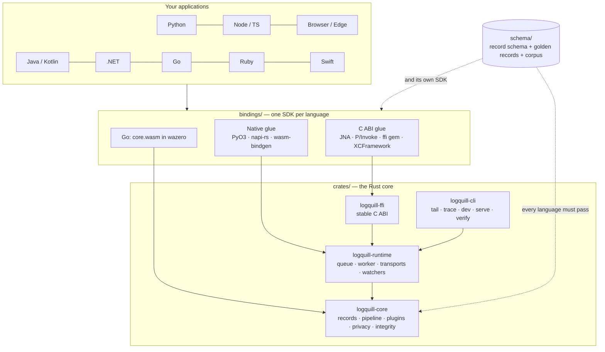
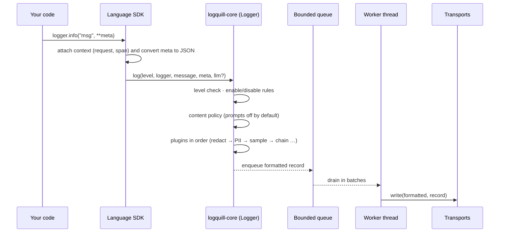

# Architecture

LogQuill is one logging library in nine languages. The behaviour that must be identical in
every language lives once, in Rust. Each language gets a thin, idiomatic SDK on top.

## The shape of it

## Layers

| Layer | Path | Owns | Does not own |
|---|---|---|---|
| Core | `crates/logquill-core` | Records, levels, the log-call pipeline, built-in plugins, privacy policy, redaction, hash chain, formatters, trace-id rules, OTel `semconv` mapping, trace-tree builder | I/O, threads, clocks (the clock is injected) |
| Runtime | `crates/logquill-runtime` | Bounded dispatch queue, one worker thread, console / file / syslog / SQLite / HTTP-family / OTLP transports, alert senders, level watchers | Anything language-specific |
| C ABI | `crates/logquill-ffi` | A stable C interface and generated header (`include/logquill.h`) | Policy: it forwards, it decides nothing |
| CLI | `crates/logquill-cli` | The `logquill` command and its embedded viewer | |
| Checks | `crates/logquill-runtime-checks` | Tests that need `unsafe` (a real `fork`, a counting allocator). Not published | |
| Bindings | `bindings/<language>` | Context propagation, framework adapters, SDK patching, host-driver transports, exit hooks | Redaction, hashing, sampling, formatting: those run in Rust |
| Schema | `schema/` | The JSON Schema of a record and the fixtures every language runs | |

The core forbids `unsafe` (`unsafe_code = "forbid"` at the workspace level). The binding macros
that expand to `unsafe` are kept out of the workspace so that this holds.

## What happens on a log call

Points worth knowing:

- **A log call never raises.** Conversion of arbitrary host objects (cycles, objects whose
  string form throws) happens in the binding with a depth cap and a string fallback.
- **Built-in plugins never cross the language boundary.** They run inside Rust. Only a
  plugin you write in the host language (`logger.use(fn)`) is a callback.
- **Privacy runs before everything else.** The content policy and redaction are applied before
  any plugin or transport sees the record. A redaction plugin that fails drops the record
  rather than letting it through.
- **The hash chain is computed where records are written**, one at a time, so the chain order
  is the file order.

## Memory is bounded everywhere

| Place | Bound |
|---|---|
| Dispatch queue | Configurable size; `drop_oldest` (default), `drop_newest` or `block`; a drop warning at most once a minute |
| Batching transports | Both record count and estimated bytes |
| Sampling / elevation / dedupe state | Capped id sets |
| Flight recorder | A strict per-run ring buffer |
| The trace viewer | Streams the log file line by line |

Backpressure and allocations per log call are measured in CI.

## Binding tiers

| Tier | Languages | How the core is reached |
|---|---|---|
| Native | Python, Node | A compiled extension (PyO3 `abi3` wheel; napi-rs addon). Node falls back to WebAssembly where no addon exists |
| WebAssembly | Browsers, Deno, Bun, Workers (`@logquill/wasm`); Go | The core compiled to Wasm; Go runs it in wazero, with no cgo |
| C ABI | Ruby, .NET, JVM, Swift | `logquill-ffi` through the language's foreign-function layer |

Every binding exposes the same names (casing aside) and the same record shape. The public names are
listed per language in [API names](api-names.md); what they guarantee is in the [contract](contract.md).

## Decisions that shape the design

- **No pure-Python or pure-TypeScript fallback.** One implementation of the logic is the point;
  the price is a prebuilt binary per platform.
- **Fail closed.** A broken redactor drops the record; a broken plugin is isolated and cannot stop logging.
- **One source of truth for conventions.** Every `gen_ai.*` attribute name lives in one file
  (`semconv`), pinned to one semantic-conventions version.
- **Host-only things stay in the host.** Context variables, stack inspection (`opt(depth)`), lazy
  callables, tracebacks, framework adapters, SDK patching and driver-based transports (Kafka, Postgres,
  Mongo …) are written in each language, because they have to touch host objects.
- **Records are mutable in the pipeline.** Plugins receive and may change the same record rather than
  a copy, which is cheaper per call. A plugin that wants the original must copy it.

## How correctness is held across nine languages

1. `schema/record.schema.json` defines a record.
2. `schema/golden_records.json`, `golden_chain.json` and `golden_otel_ids.json` pin exact outputs.
3. `schema/corpus/` is a shared set of 865 hostile-input cases across 22 groups. Each binding runs it.
4. CI runs the Rust workspace and every binding on its supported platforms, including a free-threaded
   Python job and `miri` on the worker and queue.

If you change shared behaviour, change the core and the fixtures together; see
[CONTRIBUTING](../CONTRIBUTING.md).
